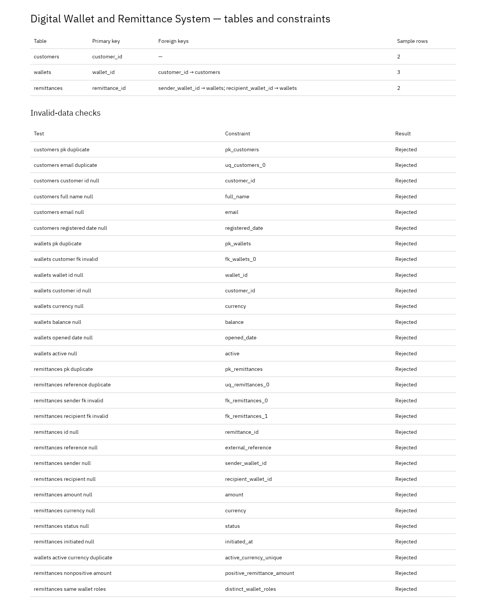

# Portfolio 1: Database Design and Modelling

Relational design for the Digital Wallet and Remittance System in PostgreSQL: entities, keys, constraints, normalisation and constraint testing.

## Design summary

Three tables in the `portfolio` schema:

| Table | Primary key | Other keys | Notes |
| --- | --- | --- | --- |
| `customers` | `customer_id` | `email` unique | Registered people who own wallets |
| `wallets` | `wallet_id` | `customer_id` → `customers` | One currency per wallet, balance, active flag |
| `remittances` | `remittance_id` | `external_reference` unique; `sender_wallet_id` and `recipient_wallet_id` → `wallets` | Amount, currency, status, `initiated_at`, optional `settled_at` |

### Business rules enforced

- Every customer has a required, unique email.
- Every wallet references an existing customer.
- A customer may have at most one active wallet per currency (unique index `active_currency_unique`).
- Remittance amounts are greater than zero (`positive_remittance_amount`).
- Sender and recipient wallets must differ (`distinct_wallet_roles`).
- Sender and recipient must both be existing wallets.
- `external_reference` is unique, so a retried submission cannot create a duplicate remittance.

Remittance currency matching the wallet currencies is a design assumption, not a database constraint.

## Normalisation

The normalisation document walks the sample data through 1NF (one value per cell), 2NF (no partial dependencies) and 3NF (each entity's details stored once, linked by foreign keys). Joining the decomposed tables reproduces the original three example rows.

## Verification

| Table | Sample rows |
| --- | --- |
| `customers` | 2 |
| `wallets` | 3 |
| `remittances` | 2 |

`ConstraintTests.sql` contains 29 deliberately invalid statements covering primary key, unique and foreign key violations, NOT NULL failures and the CHECK rules. Each was rejected with its expected SQLSTATE (23502, 23503, 23505 or 23514), and the valid sample rows were unchanged.

## Files

| File | Description |
| --- | --- |
| [Design](Akinsanmi_Christopher_301903606_P1_Design.md) | Users, operations, entities, fields, rules and assumptions |
| [ER diagram](Akinsanmi_Christopher_301903606_P1_ERDiagram.md) | Mermaid ER diagram |
| [Normalisation](Akinsanmi_Christopher_301903606_P1_Normalisation.md) | 1NF → 3NF worked example |
| [Schema](Akinsanmi_Christopher_301903606_P1_Schema.sql) | Tables, keys, indexes and CHECK constraints |
| [Sample data](Akinsanmi_Christopher_301903606_P1_SampleData.sql) | Fictional customers, wallets and remittances |
| [Constraint tests](Akinsanmi_Christopher_301903606_P1_ConstraintTests.sql) | 29 invalid inserts with expected errors |
| [Evidence](screenshots/Akinsanmi_Christopher_301903606_P1_DatabaseResults.png) | Screenshot of tables and constraint results |

## Run it

1. Create a fresh PostgreSQL database.
2. Run `Akinsanmi_Christopher_301903606_P1_Schema.sql`.
3. Run `Akinsanmi_Christopher_301903606_P1_SampleData.sql`.
4. Run each statement in `Akinsanmi_Christopher_301903606_P1_ConstraintTests.sql` one at a time, outside a transaction. Every one should fail with the error named in its comment.

## Reference

- [PostgreSQL: constraints](https://www.postgresql.org/docs/17/ddl-constraints.html)
