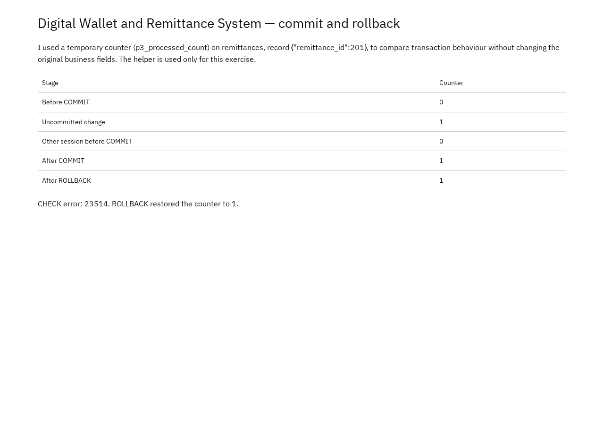
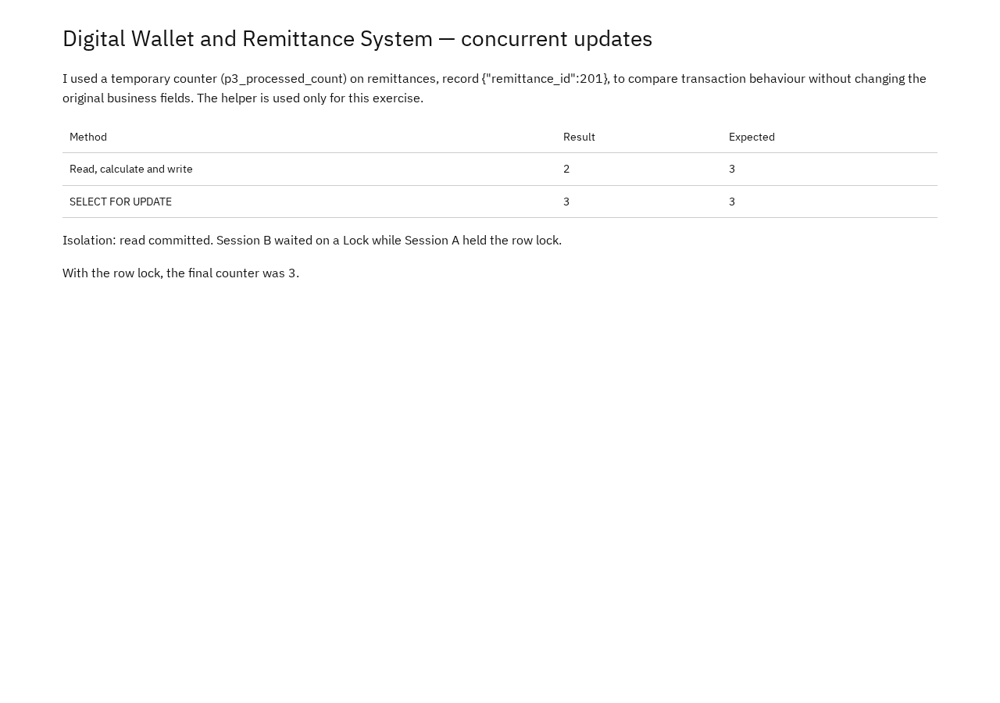

# Portfolio 3: Transactions and Concurrency

Demonstrates COMMIT, ROLLBACK, READ COMMITTED isolation and a lost-update problem fixed with row locking, using two `psql` sessions.

## Approach

A temporary helper column, `p3_processed_count`, is added to `remittances` (remittance 201) so transaction behaviour can be observed without touching the real business fields. It exists only for this exercise and is not part of the Portfolio 1 design.

## Commit and rollback

| Stage | Counter |
| --- | --- |
| Before COMMIT | 0 |
| Uncommitted change | 1 |
| Other session, before COMMIT | 0 |
| After COMMIT | 1 |
| After ROLLBACK | 1 |

- The other session could not see the uncommitted change (READ COMMITTED).
- A deliberate CHECK violation (error 23514) aborted the second transaction, and ROLLBACK restored the last committed value.

## Two-session concurrency

| Method | Final value | Expected |
| --- | --- | --- |
| Read, calculate, write | 2 | 3 |
| `SELECT ... FOR UPDATE` | 3 | 3 |

Both sessions first read the value 1. Without locking, both wrote 2 and one increment was lost. With `SELECT FOR UPDATE`, Session B waited on Session A's row lock, then read the updated value 2 and committed 3. The wait type observed was `Lock`.

## Files

| File | Description |
| --- | --- |
| [Transactions](Akinsanmi_Christopher_301903606_P3_Transactions.sql) | Adds the helper column; commit and rollback demo |
| [Session A](Akinsanmi_Christopher_301903606_P3_SessionA.sql) | Steps for the first terminal |
| [Session B](Akinsanmi_Christopher_301903606_P3_SessionB.sql) | Steps for the second terminal |

## Run it

1. Load the Portfolio 1 schema and sample data into a fresh database.
2. Run `Akinsanmi_Christopher_301903606_P3_Transactions.sql`.
3. Open two `psql` terminals connected to the same database.
4. Follow steps 1–9 across `SessionA.sql` and `SessionB.sql`, alternating between terminals as the steps direct. Run step 5 in Session A outside a transaction.

## References

- [PostgreSQL: transaction isolation](https://www.postgresql.org/docs/17/transaction-iso.html)
- [PostgreSQL: explicit locking](https://www.postgresql.org/docs/17/explicit-locking.html)
