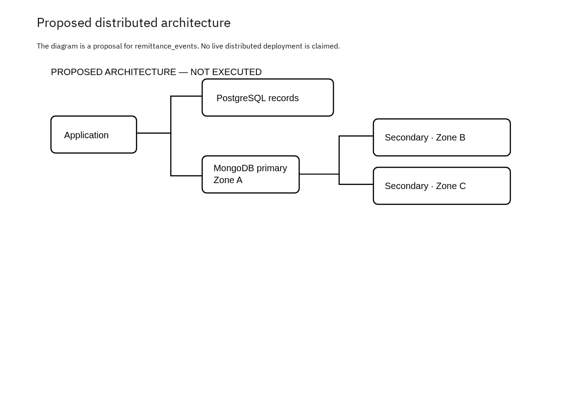

# Portfolio 5: Distributed and Cloud Databases

A proposed distributed deployment for the case study, presented as a written design discussion. **No cloud service, replica set, failover, sharding or recovery test was deployed.**

## Proposed deployment

- PostgreSQL holds the relational records and needs its own managed high-availability setup.
- MongoDB holds `remittance_events` in a **three-member replica set across three availability zones** in one region.
- The two databases are separate: a MongoDB replica set does not replicate PostgreSQL.

## Replication and availability

| Topic | Design point |
| --- | --- |
| Writes | One primary accepts writes |
| Replication | Two secondaries copy the oplog asynchronously |
| Failover | If the primary fails, a voting majority can elect a replacement; writes may pause during the election |
| Network partition | A partition without a majority cannot elect a primary |
| Placement | Three containers on one computer would not survive loss of that computer |

## Consistency choices for `remittance_events`

- Majority write concern with a finite timeout.
- Primary reads, with majority read concern where committed data is required. Secondary reads can lag.
- Retried writes carry an idempotency key so an event is not recorded twice.
- PostgreSQL constraints stay authoritative for relational rules such as unique customer emails.
- There is no atomic transaction across PostgreSQL and MongoDB. An outbox with a retrying consumer would be a separate implementation.

## Sharding trade-off

Sharding partitions data for scale; replication copies it for availability. The sample data does not need sharding. If `remittance_events` grew large, a high-cardinality source-record identifier could be evaluated as a hashed shard key:

- A time-only increasing key can concentrate new writes on one shard.
- A hashed key spreads writes but can make time-range queries touch several shards.
- Validate data distribution and query plans before choosing a key.

## Cloud deployment and recovery

A real deployment would add private networking, authentication, least-privilege roles, TLS, monitoring and tested backups. Replication also copies accidental deletions, so it does not replace backups, and availability zones do not provide regional disaster recovery.

## Files

| File | Description |
| --- | --- |
| [Detailed write-up](Akinsanmi_Christopher_301903606_P5_README.md) | Full discussion |
| [Proposed design diagram](screenshots/Akinsanmi_Christopher_301903606_P5_ProposedDesign.png) | Architecture image |

## References

- [MongoDB: replication](https://www.mongodb.com/docs/manual/replication/)
- [MongoDB: sharding](https://www.mongodb.com/docs/manual/sharding/)
